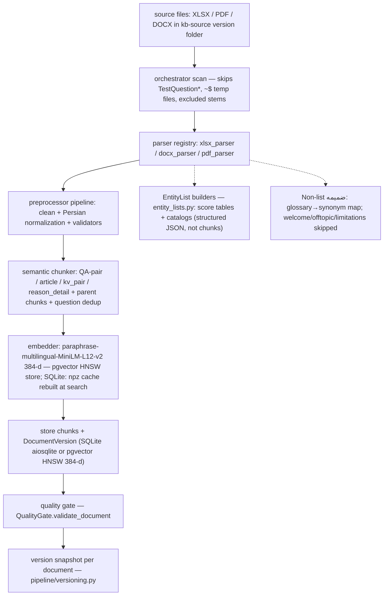
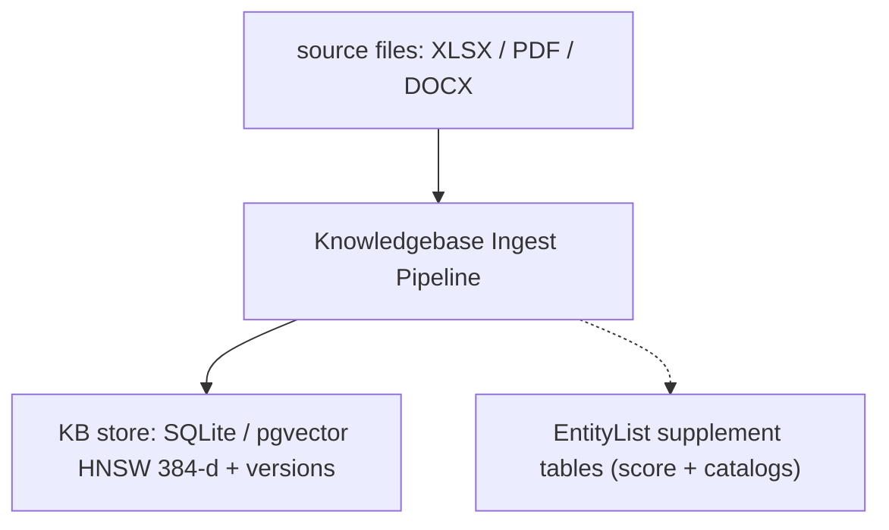
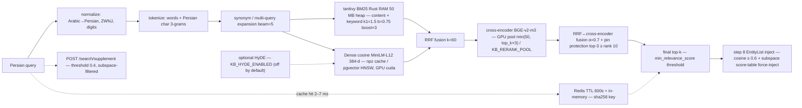
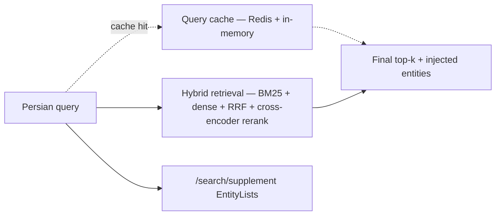
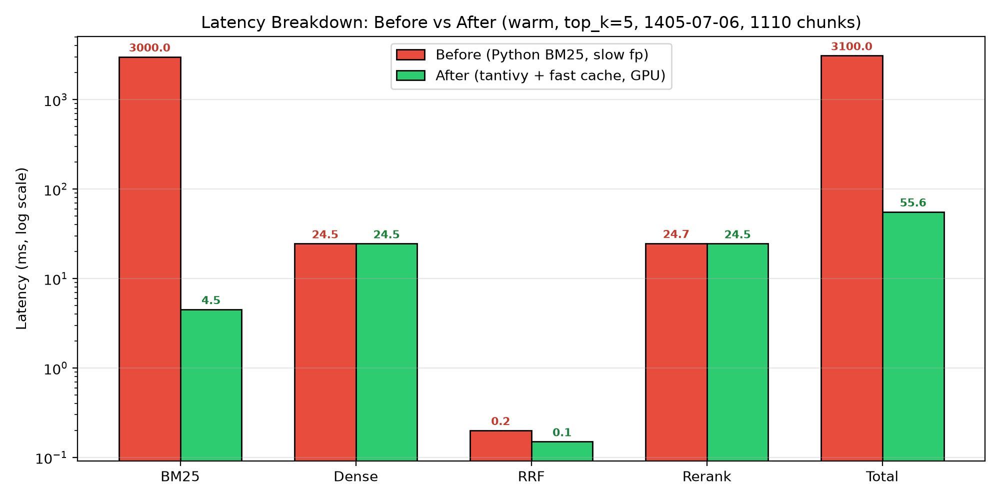
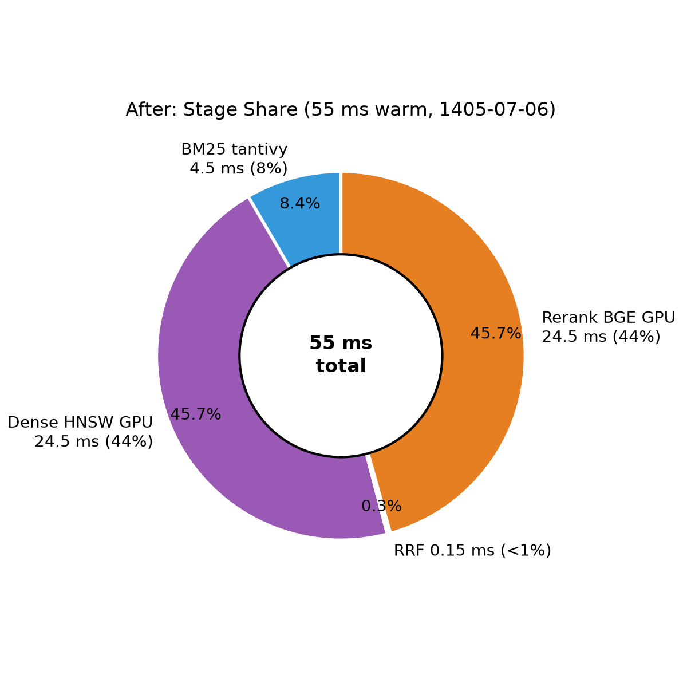
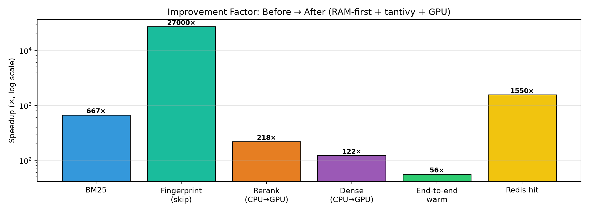
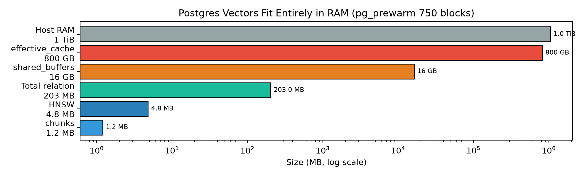

# Work RAG KB

Persian knowledge-base lifecycle, hybrid retrieval (RAM-first, Rust tantivy, GPU), and KB web UI for the Work Credit RAG platform.

> Status: **implemented, operational, RAM-first.** The retrieval pipeline and Web UI run from `kb-manager/`. Current release **v13_1405-07-06** — 18 docs / 1,123 chunks, full rebuild 2026-10-07 (`pgvector` HNSW 384d, vectors + HNSW fully in RAM `shared_buffers=16GB`, Rust tantivy BM25 50 MB RAM, GPU dense/rerank on H200). Previous **v11_1405-06-23** — 35 docs / 2,227 chunks, Hit@5 0.9306. Detailed per-version benchmark history and failure-group analysis live in `kb-manager/README.md#version-history`; this page summarizes versions and keeps only the production architecture diagrams.

---

## Summary

The Knowledgebase component owns **source documents, ingestion, indexing, retrieval, reranking, and KB evaluation**. It does **not** own model lifecycle, safety policy, conversation orchestration, or the frontend.

Core capabilities (RAM-first, v13):

- Ingest Persian `XLSX` / `PDF` / `DOCX` into a versioned KB (pgvector HNSW 384d, **all vectors + HNSW in RAM** `shared_buffers=16GB` `effective_cache_size=800GB` + `pg_prewarm`; SQLite fallback).
- Semantic chunking tuned to ICS: **QA pairs**, **reason codes**, **articles**, section headings, parent chunks, QA dedup.
- Embed with `paraphrase-multilingual-MiniLM-L12-v2` (384-dim, **GPU** `KB_EMBED_DEVICE=cuda`, H200 3 GB HBM) and cache to `.npz`.
- **Hybrid retrieval**: **Rust tantivy BM25** (RAM, 50 MB heap, whitespace over Persian 3-gram stream) + dense (GPU pgvector HNSW) → RRF fusion k=60 → cross-encoder rerank (`BAAI/bge-reranker-v2-m3`, **GPU**) — **55 ms warm** (see [Latency](#latency) with plots).
- Web UI (dashboard, documents, chunks, pipeline, search, benchmarks, versions, cleanup, monitoring) on port `8000`.
- Benchmarks UI proxies **Work_RAG-Evaluation_Suite** (`EVAL_SUITE_URL`) for live Hit@k + multiturn; quality roadmap in [`kb-manager/docs/EVAL_QUALITY_IMPROVEMENT_PLAN.md`](kb-manager/docs/EVAL_QUALITY_IMPROVEMENT_PLAN.md) (baseline 2026-11-11: Hit@5 69.7%, multiturn 7/12). Historical v11 Hit@5 0.9306 remains in `kb-manager/README.md`.

The full architecture & processing plan (data taxonomy, pgvector schema, preprocessing, chunking, embedding, hybrid retrieval, monitoring, versioning, CI/CD, roadmap) is in [`KB_ARCHITECTURE.md`](KB_ARCHITECTURE.md). IR metrics, frameworks, and evaluation theory are in [`retrieval-evaluation-research.md`](retrieval-evaluation-research.md).

<details>
<summary>Quick start</summary>

```bash
cd components/knowledgebase/kb-manager
pip install -e ".[dev]"
export KB_DB_MODE=sqlite            # sqlite (default) | pgvector
export KB_SOURCE_DIR=./kb-source    # current version folder: 1405-07-06

python -m kb_manager.cli ingest --full -s "$KB_SOURCE_DIR"   # full rebuild
python -m kb_manager.cli status                              # doc/chunk counts
python -m kb_manager.cli search -q "اعتبارسنجی چیست" -k 5   # CLI search
python -m kb_manager.cli serve                               # web on 0.0.0.0:8000
```

Useful extras: `inspect <file>` (parser dump), `status-chunks`, `dedup --dry-run`, `eval-generate` / `eval-run`.

</details>

<details>
<summary>Repository layout & code hierarchy</summary>

```text
components/knowledgebase/
├── KB_ARCHITECTURE.md            # architecture + processing plan
├── retrieval-evaluation-research.md  # IR metrics / frameworks / evaluation
├── SKILL.md                      # agent configuration
├── prismal_architecture.svg      # architecture SVG
├── docs/                         # benchmark debug + tabular chunking research
├── archive/                      # archived benchmark / implementation notes
└── kb-manager/                   # the main package
    ├── README.md                 # quick start + current retrieval metrics
    ├── pyproject.toml
    ├── run_server.py / start_server.py
    ├── Dockerfile / docker-compose.yml
    ├── kb_manager/
    │   ├── cli.py                # ingest, status, search, serve, inspect, eval-*
    │   ├── config.py / settings.py   # env-var config (DB, embedding, chunking, parser)
    │   ├── dense.py / reranker.py / tantivy_bm25.py
    │   ├── dedup.py / query_expansion.py / query_reform.py / query_enhance.py / hyde.py
    │   ├── chunker/              # base / fixed / semantic / registry
    │   ├── parsers/              # base / xlsx / docx / pdf / registry
    │   ├── preprocessor/         # clean / persian / regex_persian / validators / pipeline
    │   ├── embedder/             # base / sentence_transformer / registry
    │   ├── pipeline/             # orchestrator / quality / versioning / artifact_mgr
    │   ├── models/               # database / schemas / queries
    │   ├── web/                  # app.py + routes/ (12 routers) + templates/ + static/
    │   ├── evaluation/           # deprecated stub → Evaluation Suite HTTP
    │   ├── retrieval_training/   # mining / stage analysis packages
    │   ├── versioning/           # KB snapshot helpers
    │   └── tests/                # 17 tests
    ├── tests/
    ├── configs/                  # default.yaml + chunking/
    ├── versions/                 # KB snapshots v1, v2, v4_retrieval, v6, v7_iva, v10, v11
    ├── artifacts/                # retrieval training artifacts + report plots
    ├── data/                     # kb_*.db, dense_embeddings.npz, v10_source/, plots/
    └── pyproject.toml
```

Corpus sources live in the **`kb-source` submodule**: version folders `1405-05-31`, `1405-06-23`, `1405-07-06` (current ingestion, 18 docs / 1,123 chunks, full rebuild 2026-10-07). Previous versions kept for history; see `kb-source/README.md`.

</details>

<details>
<summary>Ingest pipeline (production code)</summary>

### Caption: Ingest pipeline — detailed technical (matches `kb_manager/pipeline/orchestrator.py`)



### Caption: Ingest pipeline — high-level black box



Pipeline: `kb_manager/pipeline/orchestrator.py` coordinates scan → parse → preprocess → chunk → embed → store → quality gate → version, with full/incremental rebuilds and versioning (`pipeline/versioning.py`). `EntityList` supplementary sheets under `ضمیمه پایگاه دانش` are built by `kb_manager/entity_lists.py` into structured `content_json` (`bands`/`color_groups` for score tables; `records`/`groups` for catalogs) and stored separately (`database.py`), not embedded as chunks. Glossary (`واژگان معادل`) updates the synonym map; welcome / offtopic / limitations docs are intentionally not EntityLists.

</details>

<details>
<summary>Retrieval pipeline (production code)</summary>

### Caption: Retrieval pipeline — detailed technical (matches `kb_manager/web/routes/search.py`)



### Caption: Retrieval pipeline — high-level black box



Flow: `POST /search/api` (`kb_manager/web/routes/search.py`). Query is normalized and tokenized (word tokens + Persian char 3-grams, stopword removal), expanded via synonym/multi-query beam (default 5), optional HyDE off. Two BM25 legs (content + keywords, `keyword_boost×3`) run on tantivy RAM index or Python fallback; dense leg uses the MiniLM-L12 384-d matrix from `data/dense_embeddings.npz` (or pgvector HNSW when `KB_DB_MODE=pgvector`). Results fuse via RRF k=60, cross-encoder rerank (`BAAI/bge-reranker-v2-m3`, GPU), then RRF↔cross-encoder score fusion α=0.7 with pin protection (BM25/merged top-3 cannot drop below rank 10), then final top-k gated by `min_relevance_threshold`. Step 8 injects `EntityList` rows whose `description_embedding` cosine ≥ 0.6 and, when a subspace/filter_path is active, force-injects the matching `score_table` so person/legal/cheque bands do not cross-bleed. `POST /search/supplement` (threshold 0.4) is the orchestrator tool path over the same EntityLists with the same subspace filter. Redis (`KB_REDIS_URL`, TTL 600 s) + in-memory fallback cache keyed by `sha256(normalized_query|top_k|boost|filter_path)`; errors never cached. `KB_FAST_CACHE=true` skips the 2.7 s per-search fingerprint scan.

### EntityList kinds (`entity_lists.py`, corpus `1405-08-20`)

| Kind | Source sheets | Structured fields | Notes |
|---|---|---|---|
| `score_table` | جداول امتیاز حقیقی / حقوقی / چک | `bands`, `color_groups`, `full_table_text` | 15 grades A1–E3; `subspace_ids` bind model to cheque vs person vs legal |
| `loan_catalog` | لیست و عناوین وام ها | `records`, `groups`, `full_list_text` | ~598 titles / 12 types |
| `shareholders` | سهامداران | `records`, `groups` | ~27 rows |
| `data_providers` | تامین‌کنندگان دیتا | `records`, `groups` | ~68 rows; neo/mobile columns preserved |
| `report_consumers` | استفاده کنندگان گزارش | `records`, `groups` | ~114 rows; openpyxl path keeps «لندتک/ریسلر» columns |

</details>

<details>
<summary>Key parameters (v13 RAM-first)</summary>

| Stage | Param | Value | Where |
|---|---|---|---|
| Postgres | `shared_buffers` / `effective_cache_size` | 16 GB / 800 GB + `pg_prewarm` (chunks 152 + HNSW 598 blks RAM) | `ALTER SYSTEM SET …` + restart |
| BM25 | engine | Rust tantivy 0.26.2, RAMDirectory heap 50 MB, whitespace over Persian 3-gram | `kb_manager/tantivy_bm25.py` |
| BM25 | k1 / b / keyword boost / n-grams | 1.5 / 0.75 / ×3 / 3 | `search.py` / `tantivy_bm25.py` |
| BM25 | beam | 5 (`KB_SYNONYM_BEAM=1` cuts 5×) | `query_expansion.py` |
| Dense | model / dim / batch / device | `paraphrase-multilingual-MiniLM-L12-v2` / 384 / 64 / cuda (H200 3 GB) | `KB_EMBED_DEVICE=cuda` |
| Dense | index | pgvector HNSW `vector_cosine_ops` m=16 ef=64, RAM (4.8 MB) + npz cache | `models/database.py` |
| RRF | k | 60 | `search.py` |
| Rerank | model / pool / device | `BAAI/bge-reranker-v2-m3` / legacy `min(50, top_k×3)` or `KB_RERANK_POOL` / cuda | `KB_RERANKER_DEVICE=cuda` `reranker.py` |
| Fusion | α (RRF↔rerank) | 0.7 | `search.py` |
| Cache | `KB_FAST_CACHE` | true (skip 2.7 s fingerprint scan) | `search.py` |
| Cache | Redis TTL | 600 s, 2–7 ms hits, 150× | `KB_REDIS_URL` |
| Chunk | strategy / max tokens | semantic / 512 | `config.py` |
| Chunk | parent max / scope | 1536 / sheet | `config.py` |

</details>

<details>
<summary>Latency — RAM-first + Rust tantivy (1405-07-06, 1110 chunks, measured 2026-10-07)</summary>

Host: 1.0 TiB RAM (867 Gi free) · 2× H200 143 GB HBM · Postgres `shared_buffers=16GB` `effective_cache_size=800GB` `pg_prewarm` · `KB_EMBED_DEVICE=cuda` `KB_RERANKER_DEVICE=cuda` (3 GB HBM) · `tantivy==0.26.2` RAM (50 MB heap) · `KB_FAST_CACHE=true` · `KB_SYNONYM_BEAM=5`.

| Stage | Before (Python BM25, CPU) | After (tantivy, GPU) | Share after |
|---|---|---|---|
| BM25 lexical (content+kw, beam5) | ~3000 ms | 3.8–5.9 ms | 7% |
| Dense cosine (pgvector HNSW, GPU) | 24 ms (CPU 3000) | 22–27 ms | 44% |
| RRF fusion k=60 | 0.1–0.2 ms | 0.1–0.2 ms | <1% |
| Cross-encoder rerank (BGE-v2-m3, GPU) | 24 ms (CPU 5400) | 21–25 ms | 44% |
| **Total warm** | **~3100 ms** / 12 s cold | **51–66 ms** avg **55 ms** | **100%** |
| Redis hit | 2–7 ms | 2 ms | 150× vs cold |
| Cold first query | 12 s | ~7–9 s one-time (lazy GPU load) | — |

**Does Postgres save vectors on RAM and leverage GPU?** No GPU — `pgvector` HNSW (`chunks_embedding_hnsw 4.8 MB`, `chunks 1.2 MB`, `pg_total_relation_size 203 MB` for 1110 chunks) lives on disk but is fully cached in RAM via `shared_buffers` + `effective_cache_size` + `pg_prewarm(152+598 blocks)`. HNSW distance (`vector_cosine_ops`) is **CPU-only**. Dense and reranker are **GPU** (H200, `torch.cuda.is_available()`, `nvidia-smi` ~3 GB for KB PID, `KB_EMBED_DEVICE=cuda` `KB_RERANKER_DEVICE=cuda`).

**Is cross-encoder on GPU?** Yes — `reranker.py` `model.to(actual_device)` `dtype=float16` on cuda. Before: CPU 5.4 s → 24 ms GPU.

</details>

<details>
<summary>Performance plots</summary>









All four plots verified present under `kb-manager/data/plots/`.

</details>

<details>
<summary>API endpoints (KB Manager)</summary>

Routers mounted in `kb_manager/web/app.py`: `/documents`, `/chunks`, `/pipeline`, `/versions`, `/monitoring`, `/search`, `/benchmarks`, `/cleanup`, `/transparency` (+ zip browser), `/ingestion` (+ KB history) — plus `/health`, `/api/health`, `/ready` and `/` dashboard. Persian RTL UI (`Vazirmatn`).

| Method | Path | Purpose |
|---|---|---|
| `POST` | `/search/api` | Hybrid search — returns step-by-step `SearchSteps` + `final_results` |
| `GET` | `/documents` | List docs (filters + pagination) |
| `GET` | `/documents/{doc_id}` | Doc detail with chunks |
| `POST` | `/documents/upload` | Upload file (creates draft doc) |
| `POST` | `/documents/{doc_id}/delete` | Soft-delete (archive) |
| `GET` | `/chunks` / `/chunks/{chunk_id}` | List / detail chunks |
| `POST` | `/chunks/{id}/verify` / `/edit` | Verify / edit chunk |
| `GET` | `/pipeline` / `POST /pipeline/run` / `GET /pipeline/status/{job_id}` | Pipeline control |
| `GET` | `/versions` / `POST /versions/{doc_id}/rollback/{version_id}` | Version history + rollback |
| `GET` | `/monitoring/staleness`, `/monitoring/metrics` | Staleness + metrics |
| `POST` | `/benchmarks/run`, `GET /benchmarks/status/{job_id}`, `GET /benchmarks/result` | Benchmark runner |

Search response (`/search/api`) returns `final_results` with `chunk_id`, `doc_id`, `doc_title`, `heading_path`, `content_preview`, `rerank_score`, `hybrid_score`, plus `injected_entities` from step 8.

</details>

<details>
<summary>CLI commands</summary>

| Command | Purpose |
|---|---|
| `kb-manager ingest [-s DIR] [--full] [-m MODEL] [--parent-scope sheet\|document]` | Ingest (full or incremental) |
| `kb-manager status` | Doc/chunk counts (rich table) |
| `kb-manager search -q "..." -k 5` | Vector search (cosine, `<=>`) |
| `kb-manager serve` | Start uvicorn web server (reload) |
| `kb-manager inspect -f file.xlsx` | Inspect file structure |
| `kb-manager eval-generate [-n N]` | Generate synthetic eval dataset |
| `kb-manager eval-run -i dataset -k N` | Run retrieval evaluation |
| `kb-manager status-chunks` | Chunk statistics (types, tokens, QA completeness) |

Entry point: `kb-manager = kb_manager.cli:main`.

</details>

<details>
<summary>Configuration (environment variables)</summary>

Defaults from `kb_manager/config.py` / `settings.py` (all overridable via `KB_*` env):

| Key | Default | Notes |
|---|---|---|
| `KB_DB_MODE` | `sqlite` | `sqlite` (aiosqlite) or `pgvector` (asyncpg); prod `pgvector` at `127.0.0.1:5433` with `shared_buffers=16GB` `effective_cache_size=800GB` + `pg_prewarm` |
| `KB_DB_URL` | — | URL override; infers mode from driver |
| `KB_SQLITE_PATH` | `./data/kb_test.db` | sqlite path |
| `KB_SOURCE_DIR` | `./kb-source` | version folder `1405-07-06` (18 docs) |
| `KB_WEB_HOST` / `KB_WEB_PORT` | `0.0.0.0` / `8000` | web server |
| `KB_EMBED_MODEL` | `sentence-transformers/paraphrase-multilingual-MiniLM-L12-v2` | embedding model |
| `KB_EMBED_DIM / BATCH` | `384 / 64` | embedding params |
| `KB_EMBED_DEVICE` / `KB_RERANKER_DEVICE` | cuda if available else `cpu` | GPU-first default; `cuda` on H200 (3 GB HBM) |
| `KB_USE_TANTIVY` | `true` | Rust tantivy RAM BM25 (50 MB heap) vs Python fallback |
| `KB_FAST_CACHE` | `true` | skip 2.7 s per-search fingerprint DB scan |
| `KB_SYNONYM_BEAM` | `5` | set `1` to cut BM25 5× |
| `KB_KEYWORD_BOOST` | `3.0` | keyword BM25 field weight |
| `KB_CHUNK_STRATEGY / MAX` | `semantic / 512` | chunking |
| `KB_CHUNK_PARENT_MAX / SCOPE` | `1536 / sheet` | parent chunks |
| `KB_CHUNK_DEDUP_QUESTIONS` | `true` | keep one canonical chunk per normalized question |
| `KB_RERANKER_MODEL` | `BAAI/bge-reranker-v2-m3` | cross-encoder (GPU) |
| `KB_RERANK_POOL` | `0` | legacy `min(50, top_k×3)`; >0 overrides cap |
| `KB_RERANK_FUSION_ALPHA` | `0.7` | RRF↔rerank fusion weight |
| `KB_REDIS_URL` | `redis://127.0.0.1:16379/0` | result cache |
| `KB_REDIS_TTL` | `600` | cache TTL seconds |
| `KB_HYDE_ENABLED` | `false` | optional HyDE |
| `KB_LLM_BACKEND` | `mock` | `mock`/`openai`/`ollama`/`vllm` (HyDE) |

</details>

<details>
<summary>Database</summary>

- **Runtime:** SQLite (`sqlite+aiosqlite`) — used by the web server and tests.
- **Production target:** PostgreSQL + pgvector (`postgresql+asyncpg`), provisioned by `docker-compose.yml` (`scripts/init_db.sql` enables `vector`, `pg_trgm`, `uuid-ossp`).
- ORM models (SQLAlchemy 2.0 async): `Document`, `Chunk` (self-FK `parent_id`, `embedding_model`, `quality_score`, `is_verified`), `DocumentVersion`, `IngestionJob`, `RetrievalLog`, `EntityList`.

```bash
cd kb-manager
docker compose up -d   # pgvector on :5432 + kb-manager on :8000
```

</details>

<details>
<summary>Tests</summary>

| File | Covers |
|---|---|
| `test_chunker.py` | semantic chunking, incomplete-QA skip, parent scope, QA Persian field formatting, FixedChunker |
| `test_parsers.py` | XLSX (reason_codes, crm_qa), DOCX, parser registry |
| `test_preprocessor.py` | Persian normalization, HTML/URL/whitespace, pipeline quality |
| `test_pipeline.py` | orchestrator scan (full vs incremental) |
| `test_embedder.py` | dims, query embed, content-hash cache |
| `test_evaluation.py` | Ranx vs pure-Python fallback, Ragas availability |
| `test_cli.py` | version, inspect |

```bash
cd kb-manager
pytest tests/ -v
```

Validated: `compileall` clean · `pytest` **116 passed**, 6 skipped, 1 pre-existing env-dependent failure (`test_qa_massive_count` — newest `kb-source/1405-*` folder exposes 4 QA files < 5).

</details>

<details>
<summary>Libraries & versions</summary>

| Layer | Libraries / models (pinned in `pyproject.toml`) |
|---|---|
| API / server | `fastapi>=0.115.0`, `uvicorn[standard]>=0.30.0`, `jinja2`, `python-multipart`, `pyyaml` |
| Data | `sqlalchemy[asyncio]>=2.0.0` (`aiosqlite` / `asyncpg`), `pgvector>=0.3.0`, `psycopg2-binary>=2.9.0` |
| Retrieval | `sentence-transformers>=3.0.0` (MiniLM-L12 384d, GPU), `torch>=2.0.0` (cuda, H200), `tantivy==0.26.2` (Rust BM25, RAM), `numpy>=1.24.0` |
| Persian NLP | `hazm>=0.10.0`, `shekar>=0.5.0` + local `regex_persian.py` maps |
| Parsing | `openpyxl>=3.1.0` (+calamine engine option), `python-docx>=1.1.0`, `PyMuPDF>=1.24.0`, `pandas>=2.0.0,<2.1.0` |
| CLI | `click>=8.1.0`, `rich>=13.0.0` (`kb-manager = kb_manager.cli:main`) |
| Cache (optional) | `redis` async client (lazy import, TTL 600 s, 2–7 ms hits) + in-memory dict fallback |
| Dev / QA | `pytest>=8.0.0`, `pytest-asyncio>=0.23.0`, `pytest-cov>=5.0.0`, `httpx>=0.27.0`, `ruff>=0.5.0`, `mypy>=1.10.0` |
| Reporting (optional) | `matplotlib` (plots), `fpdf2` (PDF export) |

Models:
- Embedding: `sentence-transformers/paraphrase-multilingual-MiniLM-L12-v2` (384-d)
- Reranker: `BAAI/bge-reranker-v2-m3`

</details>

<details>
<summary>Version summary (changelog)</summary>

| Ver | Corpus | Key change | Benchmark (measured) |
|---|---|---|---|
| v1 | ~160 files (31Tir1405) | baseline ingest + BM25 | — |
| v2 | 355 docs / 6,208 chunks | BM25 + TF-IDF RRF k=60 | Hit@5 90%, MRR 0.736 |
| v3 | 355 docs / 6,208 chunks | + dense MiniLM-L12 | Hit@5 89.2%, MRR 0.787 |
| v4 | 355 docs / 6,208 chunks | + char 3-grams + cross-encoder rerank | Hit@5 90%, MRR 0.775 |
| v5 | 355 docs / 6,208 chunks | frozen dataset BM25×3 | Hit@5 84.2%, MRR 0.751 |
| v6 | 69 docs / 3,626 chunks | P0–P8 remediation, synonym beam5, MinHash dedup | 10-q smoke 100% Hit@5 |
| v7 | 34 docs / 2,074 chunks | fresh 1405-05-31 KB, colloquial expansion, IVA-15 | doc-Hit@5 73.3% |
| v8 | 103 docs / 6,593 chunks | pgvector HNSW-384, tunable keyword×3.0 | HNSW GPU 18.4 s |
| v9 | 21+32 docs / ~1,084 chunks | KB_9.7.2026 type-aware, transparency/zip | IVA 11/15 |
| v10 | 35 docs / 2,282 chunks | 1405-06-23, kv/single-col schemas, stage bench | Hit@5 0.9244 |
| v11 | 35 docs / 2,227 chunks | chunkfix rebuild, dense `use_context=False` | Hit@5 0.9306, MRR 0.8281 |
| v12 | same v11 KB | typo corrections, exclusive-term beam, Redis cache | SYNONYM_MAP 93 entries |
| v13 | 18 docs / 1,123 chunks | `1405-07-06`, RAM-first: tantivy RAM BM25, pgvector 16 GB shared_buffers + `pg_prewarm`, GPU dense/rerank H200 | latency **55 ms**, Hit@5 pending re-benchmark |

v11 manifest: `kb-manager/versions/v11_1405-06-23/manifest.json`. v13-RAM is code + infra (RAM-first tuning) on top of v13.

</details>

<details>
<summary>Architecture diagrams (production code)</summary>

### Ingest pipeline — detailed technical

See the **Ingest pipeline (production code)** section above for the detailed technical variant and high-level black box variant with captions.

### Retrieval pipeline (per query) — detailed technical

See the **Retrieval pipeline (production code)** section above for the detailed technical variant and high-level black box variant with captions.

Both diagrams validated against `kb_manager/kb_manager/`: `pipeline/orchestrator.py`, `parsers/`, `preprocessor/`, `chunker/`, `dedup.py`, `embedder/`, `models/database.py`, `web/routes/search.py`, `tantivy_bm25.py`, `dense.py`, `reranker.py`, `config.py`.

</details>

---

## License

See parent repository `LICENSE` and the submodule's own obligations (`kb-manager` is private — ICS Credit Scoring).

<!-- docs-toc:start -->
## Documentation Index

> Auto-generated from this repository's tracked Markdown notes (**49** files). Refresh with `python scripts/gen_readme_toc.py` — the `docs-toc` workflow does this automatically on push.

### Repository root

- [ICS Knowledge Base Architecture & Processing Plan](KB_ARCHITECTURE.md) — 1. Current KB Analysis
- [Claude Code Configuration - OpenCode Orchestrator](SKILL.md) — coder, reviewer, tester, planner, researcher
- [Retrieval Evaluation Methods, Frameworks & Metrics](retrieval-evaluation-research.md) — where rel(k) is 1 if document at rank k is relevant, 0 otherwise

### `.agent/`

- [Plan: Fix All Weak Spots (W1-W5) — One-by-One with Benchmark Regeneration](.agent/plans/abstract-dreaming-ostrovsky.md) — User requested comprehensive fix for all retrieval weak spots across v2→v4, with per-fix benchmark regeneration, across all complexities (Low/Med/Hig…

### `archive/`

- [KB Manager Retrieval Benchmark Comparison: v2 → v3 → v4](archive/BENCHMARK_COMPARISON.md) — 1. Cross-encoder reranker significantly improves ranking quality
- [KB Manager - Retrieval System v4 Implementation Plan](archive/IMPLEMENTATION_PLAN.md) — Complete overhaul of the retrieval system with 7 improvement methods, synthetic data generation pipeline, and comprehensive documentation.
- [Persian NLP Resources for KB Manager](archive/PERSIAN_RESOURCES.md) — Comprehensive catalog of Persian (Farsi) datasets, models, and tools relevant to the KB Manager retrieval system.
- [KB Manager — Implementation Plan v3](archive/PLAN.md)

### `kb-manager/`

- [KB Manager — Persian RAG Knowledge Base](kb-manager/README.md) — The pipeline now includes a 3-way LLM classifier (nodes/classify.py) that routes every query into one of three categories before retrieval, plus an M…
- [v10 failure group: A_company (24 samples)](kb-manager/artifacts/retrieval_training/rca/group_A_company.md) — 1. [Company_CRM_Questions] score=447.2601 :: ...‌از زمان دقیق بروزرسانی، میتوانید به لینک زیر مراجعه کنید: https://ics24.ir/about/updatecreditor کلید…
- [v10 failure group: A_individual (12 samples)](kb-manager/artifacts/retrieval_training/rca/group_A_individual.md) — 1. [Cheque_ReasonCode_for_Chatbot] score=525.2788 :: ...‌کلیدواژه‌ها: تاخیر,چک برگشتی,رفع سوءاثر کد دلیل: -‌... | کلیدواژه‌ها: تاخیر,چک برگشتی,رفع سو…
- [v10 failure group: A_public (10 samples)](kb-manager/artifacts/retrieval_training/rca/group_A_public.md) — 1. [ChequeQuestions] score=472.1116 :: ...‌که در نهایت باعث کسب رتبه A برایش شده است. کلیدواژه‌ها: تعداد زیاد چک، مبلغ زیاد چک، تعهدات بالا، ریسک بال…
- [v10 failure group: BC (8 samples)](kb-manager/artifacts/retrieval_training/rca/group_BC.md) — 1. [Company_CRM_Questions] score=901.47 :: ...‌همان شناسه ملی ارسال شود، گزارش اعتباری شرکت به‌صورت خودکار به‌روزرسانی خواهد شد. کلیدواژه‌ها: شناسه م…
- [LLM-judge corpus — A_company (24 failures)](kb-manager/artifacts/retrieval_training/rca_judge/judge_A_company.md)
- [LLM-judge corpus — A_individual (12 failures)](kb-manager/artifacts/retrieval_training/rca_judge/judge_A_individual.md)
- [LLM-judge corpus — A_public (10 failures)](kb-manager/artifacts/retrieval_training/rca_judge/judge_A_public.md)
- [LLM-judge corpus — BC (8 failures)](kb-manager/artifacts/retrieval_training/rca_judge/judge_BC.md)
- [KV / Tree / Variable Chunking Plan — KB 1405-06-23 (41 files)](kb-manager/docs/KV_CHUNKING_PLAN.md) — Audit tool: kb_manager/parsers/{xlsx_parser,docx_parser,pdf_parser}.py (existing code).
- [KB Manager — Evidence-Based Remediation Plan](kb-manager/docs/REMEDIATION_PLAN.md) — This plan verifies every reported finding, maps system flows, and provides a phased implementation roadmap an engineer can execute safely. Untracked…
- [KB Manager Technical Documentation](kb-manager/docs/index.md) — Persian RAG Knowledge Base — Technical Reports
- [Synthetic Generation — Remote 2×GPU Gemma 30B Execution Guide](kb-manager/docs/reports/SYNTHETIC_GEMMA_REMOTE.md)
- [Comprehensive Report — W1 Keyword-only & W5 Evaluation Coverage](kb-manager/docs/reports/W1_W5_comprehensive_report.md) — Keyword-only benchmark queries (format_keyword_only) have Hit@5 33-45% across v2→v4 (vs 90% overall). MRR 0.180→0.333 (+85% after v4 char n-grams) bu…
- [Root-Cause Analysis — v10 1405-06-23 retrieval failures](kb-manager/docs/retrieval_training/RCA_v10_README.md) — This document analyses all 54 failures (46 A + 6 B + 2 C) sample-by-sample. Every failure was dumped with its full gold text, its actual retrieved te…
- [Evaluation (design stub)](kb-manager/docs/retrieval_training/evaluation.md) — Reuse kb_manager/evaluation/metrics.py: RetrievalMetrics.compute_all
- [Retrieval failure analysis (Agent 2 — v10 frozen baseline)](kb-manager/docs/retrieval_training/failure_analysis.md)
- [Retrieval failure analysis (Agent 2 — v10_1405-06-23 corpus)](kb-manager/docs/retrieval_training/failure_analysis_v10_1405-06-23.md)
- [Hard-Negative Mining (tier design + proportions + provenance)](kb-manager/docs/retrieval_training/hard_negative_mining.md) — Mined per query against the frozen pipeline
- [Repository Audit (from code inspection, 2026-09-12)](kb-manager/docs/retrieval_training/repository_audit.md) — Source of truth is the code cited per row; the brief's "verified facts" were
- [Training (design stub)](kb-manager/docs/retrieval_training/training.md) — Two fine-tuning tracks consume the stage-3 dataset; both are contract-only
- [Synthetic Data Generation with Gemma 30B](kb-manager/docs/synthetic-generation.md) — Complete guide for generating synthetic Persian QA and conversational data using Gemma-2-27B on dual-GPU setup.
- [Technical Report](kb-manager/docs/technical-report.md) — Embedding Model, Retrieval Methods & Evaluation Metrics for Persian RAG Knowledge Base
- [KB Manager content packs](kb-manager/packs/README.md) — Versioned YAML packs served by GET /registry/api/ and loaded at ingest/search time.
- [KB corpus 1405-08-20 — problems report](kb-manager/reports/1405-08-20/PROBLEMS_REPORT.md) — Generated during ingest-preflight. Supplementary material is listed for routing only; it must not be vectorized as general KB chunks.
- [Off-topic patterns from سوالات نامربوط.xlsx](kb-manager/reports/1405-08-20/offtopic_summary_for_guardrails.md) — Use in guardrails judge prompts. Do not ingest these rows into the vector DB.
- [Applied to code (2026-11-11)](kb-manager/reports/1405-08-20/subspace_distill/APPLIED.md)
- [Method notes — subspace distill](kb-manager/reports/1405-08-20/subspace_distill/METHOD_NOTES.md) — Important confusion buckets were quota-filled first (cheque↔facilities_person, facilities_person↔facilities_legal, credit_ladder↔facilities_person, g…
- [Subspace QA distill — 1405-08-20](kb-manager/reports/1405-08-20/subspace_distill/README.md) — 1. Walk all .xlsx under kb-source/1405-08-20/پایگاه دانش.
- [Verification — subspace distill & draft prompts v1.0.4](kb-manager/reports/1405-08-20/subspace_distill/VERIFICATION.md) — 1. Mega-cluster (facilities_person_c00, size 330): ~73% of subspace in one blob; summaries collapse to generic «امتیاز/اقساط». Confirms METHOD_NOTES…
- [Recursive subspace summaries](kb-manager/reports/1405-08-20/subspace_distill/recursive_summaries.md) — Per-subspace cluster summaries followed by a rollup paragraph.
- [KB Version Snapshots](kb-manager/versions/README.md) — Archived KB exports — each v/ is a full kb_export.json + manifest.json at a pipeline checkpoint.
- [KB Version v1](kb-manager/versions/v1/README.md)
- [KB Version v10_1405-06-23](kb-manager/versions/v10_1405-06-23/README.md)
- [v10 — KB 1405-06-23 ingest report (2026-09-16)](kb-manager/versions/v10_1405-06-23/V10_REPORT.md) — Source: 1405-06-23.zip (41 files) staged with cleanup:
- [Knowledge Base Version 11 — 1405-06-23 (Post-Chunkfix Rebuild)](kb-manager/versions/v11_1405-06-23/README.md) — This is version 11 of the Persian RAG Knowledge Base, built from the source directory data/v10_source/1405-06-23 (41 xlsx files → 35 documents after…
- [KB Version v2](kb-manager/versions/v2/README.md)
- [KB Version v4_retrieval](kb-manager/versions/v4_retrieval/README.md)
- [KB Version v6](kb-manager/versions/v6/README.md)
- [IVA Test — v7 (1405-05-31 KB)](kb-manager/versions/v7_iva_1405-05-31/IVA_REPORT.md) — Source: kb-source/1405-05-31 (34 docs, 2074 chunks)
- [KB Version v7_iva_1405-05-31](kb-manager/versions/v7_iva_1405-05-31/README.md)

<!-- docs-toc:end -->
