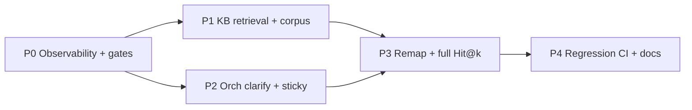

# Evaluation quality improvement plan

**Status:** planned (2026-11-11)  
**Baseline:** Evaluation Suite diagnose on live local stack  
**Sole eval backend:** `Work_RAG-Evaluation_Suite` (`EVAL_SUITE_URL`, compose service `evaluation:8300`)  
**KB role:** corpus + hybrid retrieval + `/benchmarks` UI proxy (no local eval backend)

Related:

- Suite diagnosis: `components/evaluation/docs/DIAGNOSIS_2026-11-11.md`
- Suite results: `components/evaluation/docs/RESULTS_2026-11-11.md`
- Multiturn goldens: `components/evaluation/datasets/multiturn/conversations_v1.yaml`
- Hit@k goldens: `components/evaluation/datasets/retrieval/eval_clean_remapped.json`

---

## 0. Baseline (do not regress)

| Suite | Metric | Baseline (pre-fix) | After 2-round multiagent (2026-11-12) | Near-term target | Stretch |
|---|---|---|---|---|---|
| Hit@k remapped | n | 165 @ ov≥0.30 (noisy) | **82 strict** @ ov≥0.75 | keep strict set | live remap ≥0.75 |
| Hit@k | Hit@1 | **57.6%** (noisy) | **86.6%** strict | ≥70% | ≥80% ✓ |
| Hit@k | Hit@5 | **69.7%** (noisy) | **98.8%** strict | ≥85% ✓ | ≥92% ✓ |
| Hit@k | MRR | 0.622 | **0.916** strict | ≥0.75 ✓ | ≥0.85 ✓ |
| Multiturn | pass | **7/12** | **12/12** ✓ | **10/12** ✓ | **12/12** ✓ |
| Multiturn | clarify_miss | 2 | **0** | 0 ✓ | 0 |
| Multiturn | over_clarify | 1 | **0** | 0 ✓ | 0 |
| Multiturn | sticky/subspace fail | 3 | **0** | ≤1 ✓ | 0 ✓ |

**Judge stop (Round 2):** multiturn stretch + Hit@k stretch on strict goldens met. Remaining soft work: live re-remap at 0.75; Hit@1 soft-miss (~11/82); merge uncommitted orch/eval/KB fixes.

**Gate command** (from repo root, suite + KB + orch up):

```bash
docker compose -f deploy/compose/compose.base.yml -f deploy/compose/compose.local.yml \
  --env-file deploy/compose/.env --profile eval up -d evaluation
PYTHONPATH=components/evaluation/src python components/evaluation/scripts/diagnose.py --hitk-limit 200
# or full: omit --hitk-limit
```

KB UI check: `http://127.0.0.1:8000/benchmarks` → Evaluation Suite **online**.

---

## 1. Problem summary (why answers go wrong)

### 1.1 Single-turn (retrieval → wrong facts)

Wrong / thin answers when the gold chunk is missing from top-k:

| Mode | Count (baseline) | Meaning |
|---|---|---|
| Hard miss (not in top-5) | ~50 | Wrong neighbor context or empty useful context |
| Soft miss (in top-5, not #1) | ~20 | Rerank/fusion prefers lexical neighbor |
| Remap drop | 35 | Answer text gone from corpus — unscoreable |

**Themes in hard misses:** API/cloud/ops, cross-source data fusion, niche ضمیمه tables/roles, edge cheque/payment policy.

### 1.2 Multi-turn (routing → wrong dialogue)

| Class | Count | Product meaning |
|---|---|---|
| `clarify_miss` | 2 | «وضعیت اعتباری چطور است» answers instead of clarifying |
| `over_clarify` | 1 | «اعتبارسنجی چیست» asks nardban/kafil instead of FAQ |
| sticky / subspace | 3 | Facilities sticky leaks; CEO / board re-spec fails; missing `applied_subspace` |

Orchestrator often omits `rag.applied_subspace` → suite infers from text → some `None` scores are **instrumentation**, not routing.

---

## 2. Ownership map

| Workstream | Owner repo | Path |
|---|---|---|
| Corpus coverage, chunking, hybrid search, EntityList | **Work_RAG-KB** | `kb-manager/` |
| Classify / clarify / sticky / re-spec / `applied_subspace` | **Work_RAG-Orchestrator** | `components/orchestrator` |
| Eval goldens, diagnose, gates | **Work_RAG-Evaluation_Suite** | `components/evaluation` |
| Compose `EVAL_SUITE_URL` / profile `eval` | **parent** | `deploy/compose/` |
| Guarded generate / content_filter | Work_RAG-Guardrails | only if offtopic regressions |

Do **not** reintroduce `kb_manager.evaluation` backend. Suite talks HTTP only (`/search/api`, orch chat).

---

## 3. Phased plan



Work **P0 → P1 and P2 in parallel** after orch emits subspace. Fix order for user-visible quality: P2 clarify/FAQ (cheap, high UX) ‖ P1 corpus gaps (Hit@k) → P3 full remap → P4 CI.

---

## 4. Tasks and subtasks

### P0 — Observability, harness, measurement hygiene

**Goal:** Separate real routing bugs from scoring noise; one command to re-baseline.

| ID | Task | Owner | Subtasks | Done when |
|---|---|---|---|---|
| P0.1 | Emit `applied_subspace` (and sticky) on chat `rag` | Orch | (a) Add fields in format/response path (b) Sticky + re-spec update them (c) Suite prefers metadata over lexical inference | Multiturn legal open turn scores `facilities_legal` without content heuristics |
| P0.2 | Suite scorer uses metadata first | Eval | (a) Read `rag.applied_subspace` (b) Keep inference as fallback only (c) Tag turns `inferred=true` in report | diagnose JSON shows `source: metadata\|inferred` |
| P0.3 | Freeze diagnose artifacts in PR checklist | Eval + parent | (a) Document gate in this plan (b) Parent PR template checkbox (c) Optional CI job `profile=eval` smoke `/health` | README + PR checklist list the gate |
| P0.4 | KB `/benchmarks` proxy polish | KB | (a) Show Hit@1/Hit@5/MRR + multiturn pass (b) Link to suite diagnose MD (c) Disable retired ragas/massive with 410 + message | UI online; no 500 on null latency |

### P1 — KB retrieval & corpus (Hit@k)

**Goal:** Hit@5 ≥ 85% on remapped `eval_clean` after coverage + ranking passes.

| ID | Task | Owner | Subtasks | Done when |
|---|---|---|---|---|
| P1.1 | Miss catalog from diagnose | KB + Eval | (a) Export 50 miss@5 queries + got IDs (b) Bucket: ops/API, fusion, tables, policy, other (c) Check whether gold text exists anywhere in DB | Spreadsheet/MD of buckets with “missing doc” vs “rank fail” |
| P1.2 | Corpus fill for hard-miss themes | KB | (a) Locate source in `kb-source` / packs (b) Re-ingest or add ضمیمه/EntityList rows (c) Verify answer-as-query finds chunk | Remap drop ↓; sampled misses become rank≥1 or ≤5 |
| P1.3 | EntityList / score-table inject for tabular misses | KB | (a) Map miss queries to score_table / loan_catalog / roles (b) Ensure dense inject + supplement search (c) Orch trim already ranks supplements — re-test Hit@k with filter | Tabular theme Hit@5 improves on subsample |
| P1.4 | Soft-miss ranking pass | KB | (a) Sample 20 in-top-5-not-1 (b) Compare BM25 vs dense vs RRF vs rerank stage lists (c) Tune: expansion synonyms, RRF k, rerank pool, Persian n-grams (d) Avoid overfitting to 20 | Soft-miss count ≤10 on same 165 |
| P1.5 | Stage funnel dump on remapped set | KB | (a) Optional stage JSONL for remapped 165 (b) Label A / A′ / B like legacy v11 funnel (c) Compare to v11 Cheque=0 A-miss | Written funnel on current corpus |
| P1.6 | Cache / offline embed consistency | KB | (a) Confirm embed backend matches index dim (local 384) (b) No OpenRouter embed against MiniLM index (c) Document in restart runbook | Health shows matching embed; Hit@k stable after recreate |

### P2 — Orchestrator dialogue routing (multiturn)

**Goal:** Multiturn ≥ 10/12; zero clarify_miss and over_clarify on `conversations_v1.yaml`.

| ID | Task | Owner | Subtasks | Done when |
|---|---|---|---|---|
| P2.1 | Force clarify on bare credit-status | Orch | (a) Intent rule / classifier: «وضعیت اعتباری چطور است» (+ close paraphrases) → clarify (b) Do not answer from general sticky (c) Golden: `conv_cheque_02`, `conv_facilities_person_01` turn 1 | Both turns `finish=clarify` |
| P2.2 | FAQ exemption for «اعتبارسنجی چیست» | Orch | (a) Definition/FAQ list before nardban/kafil disambiguation (b) Route `general` + retrieve (c) Golden: `conv_greeting_faq` | `finish=stop`, subspace general, no “نردبان/کفیل” clarify |
| P2.3 | Re-spec beats sticky | Orch | (a) Board / shareholders / CEO / company-intro cues clear facilities sticky (b) Explicit “هیچکدوم…” after clarify → general (c) Goldens: `conv_facilities_legal_01` t2, `conv_general_02` t2 | Expected subspaces match; CEO not empty if KB has content |
| P2.4 | Facilities_legal open detection | Orch | (a) «تسهیلات … حقوقی» / limitations language sets sticky legal (b) Emit applied_subspace (c) Golden legal_01 t1 | Metadata = `facilities_legal` |
| P2.5 | Empty-answer path for CEO/shareholders | Orch + KB | (a) If general re-spec + entity/supplement available, force supplement retrieve (b) Align with EntityList shareholders path (c) Avoid premature “یافت نشد” | `conv_general_02` / supplement convs pass with evidence |
| P2.6 | Multiturn suite tighten | Eval | (a) After P0.1, remove weak inference-only passes if needed (b) Add 2–3 paraphrases for clarify/FAQ (c) Keep labels product-correct | Suite still 12 core convs; optional `conversations_v1b.yaml` |

### P3 — Remap, full Hit@k, acceptance

| ID | Task | Owner | Subtasks | Done when |
|---|---|---|---|---|
| P3.1 | Full remap after corpus changes | Eval | (a) `scripts/remap_hitk_dataset.py` from legacy (b) Commit remapped JSON (c) Note kept/dropped | New remapped file + diagnose |
| P3.2 | Full Hit@k (no limit) | Eval | (a) Run all remapped rows (b) Update RESULTS + DIAGNOSIS dates (c) Diff vs baseline table §0 | Hit@5 ≥ target or documented gap |
| P3.3 | Multiturn full pass | Eval | (a) `run_multiturn.py` (b) Taxonomy zero on P2 classes | ≥10/12; ideally 12/12 |
| P3.4 | Dual sign-off | KB + Orch | (a) KB PR: retrieval metrics (b) Orch PR: multiturn (c) Parent pin both + suite | Parent health + diagnose green |

### P4 — Regression & docs

| ID | Task | Owner | Subtasks | Done when |
|---|---|---|---|---|
| P4.1 | CI smoke | Parent | (a) Job: suite `/health` + KB proxy online (b) Optional nightly diagnose truncated (c) Do not block on full Hit@k until stable | Workflow exists |
| P4.2 | README sync | KB | (a) Keep this plan + baseline table current (b) Strike stale “kb_manager.evaluation backend” claims (c) Point benchmarks UI → suite | This file + kb-manager README agree |
| P4.3 | Agent-state / AUDIT | Eval + agent-state | (a) Update AUDIT KB-eval row (done) (b) Note tip: diagnose before claiming Hit@k | Insights mention sole suite |

---

## 5. Suggested execution order (when we start fixing)

1. **P0.1 + P0.2** — orch `applied_subspace` + suite metadata (unblocks honest multiturn scoring).  
2. **P2.1 + P2.2** — clarify_miss + over_clarify (fast UX wins, 3 fails).  
3. **P2.3 + P2.4 + P2.5** — sticky / re-spec / CEO.  
4. **P1.1 → P1.2 → P1.3** — miss catalog → corpus/EntityList fill.  
5. **P1.4 + P1.5** — ranking soft-miss.  
6. **P3.*** — full remap + diagnose; raise targets.  
7. **P4.*** — CI + docs freeze.

---

## 6. Out of scope (defer)

- Restoring KB-local ragas / massive QA / IVA runners  
- Guardrails policy rewrites unless multiturn offtopic regresses  
- Replacing MiniLM/BGE models (only after corpus + ranking exhausted)  
- Perfect Hit@k on unremappable dropped rows without restoring source docs  

---

## 7. Working agreement

- Fix in **owning submodule**; advance parent gitlink after merge.  
- Every retrieval claim backed by Evaluation Suite diagnose (not anecdotal chat).  
- Prefer small PRs: one theme (clarify FAQ ≠ full Hit@k retune).  
- After each merged fix: re-run diagnose; update baseline table in this doc.
